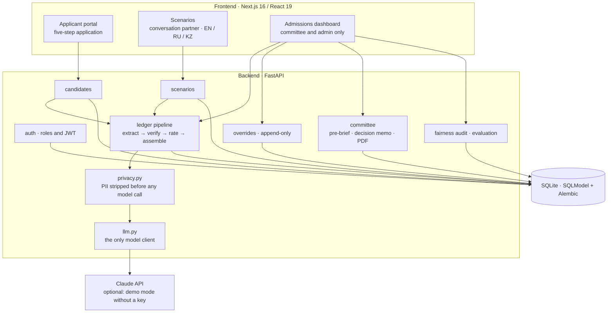
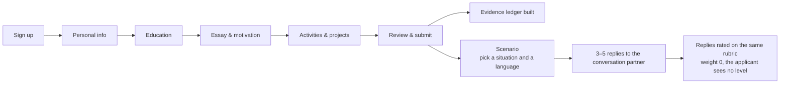
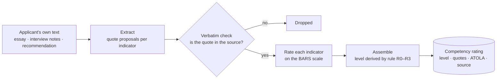
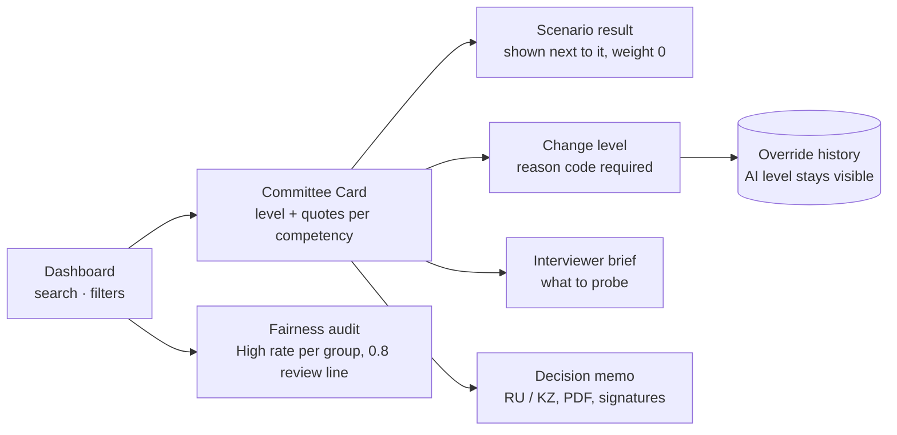

# inVision U — Solution Architecture

## 1. System overview

The browser only talks to the frontend; Next.js proxies `/api` to the backend.
Every router checks the caller's role (`backend/routers/guards.py`).

## 2. Applicant flow

## 3. Evidence ledger pipeline

- **Levels:** High / Normal / Weak / *No evidence*. "No evidence" is its own
  state, never a low score. A claim without described behaviour is capped at
  Normal.
- **Determinism:** the competency level is derived from indicator ratings by a
  fixed rule, so the same evidence always yields the same level.
- **Versions:** rubric and prompt content are hashed in
  `backend/ledger/versions.lock.json`; CI fails on a change without a version bump.
- **Demo mode:** without a model key, `backend/ledger/demo.py` replaces the
  model calls (hand-authored quotes for the 16 seed applicants, rule-based
  extraction for new ones). Every quote still passes the real verbatim check,
  and every view is labelled *"Demo mode · no live model"*.

## 4. Committee flow

## 5. Fairness

- Scoring never reads school type, region, GPA, income, gender, application
  language, essay length or manner of speech
  (`tests/test_no_demographics_in_scoring.py` fails the build otherwise).
- The fairness audit compares the share of each group rated High per
  competency, with 95% bootstrap intervals; groups with n < 10 are marked
  "Not enough data".
- Swap-and-rescore changes name, region, school type, language and speech
  style and checks whether any level flips.

## 6. Data model

| Table | Holds |
|-------|-------|
| `applicants`, `artifacts` | applications and their documents |
| `users` | accounts and roles (applicant, interviewer, committee, admin) |
| ledger runs and scores | stored evidence ledgers with versions |
| `overrides`, audit log | committee changes, append-only |
| `feynman_sessions`, `scenario_results` | scenario conversations and their ratings |
| signatures | decision-memo sign-off |

Migrations live in `backend/migrations/`; `python -m backend.db init` brings a
database to head and seeds the demo data.
